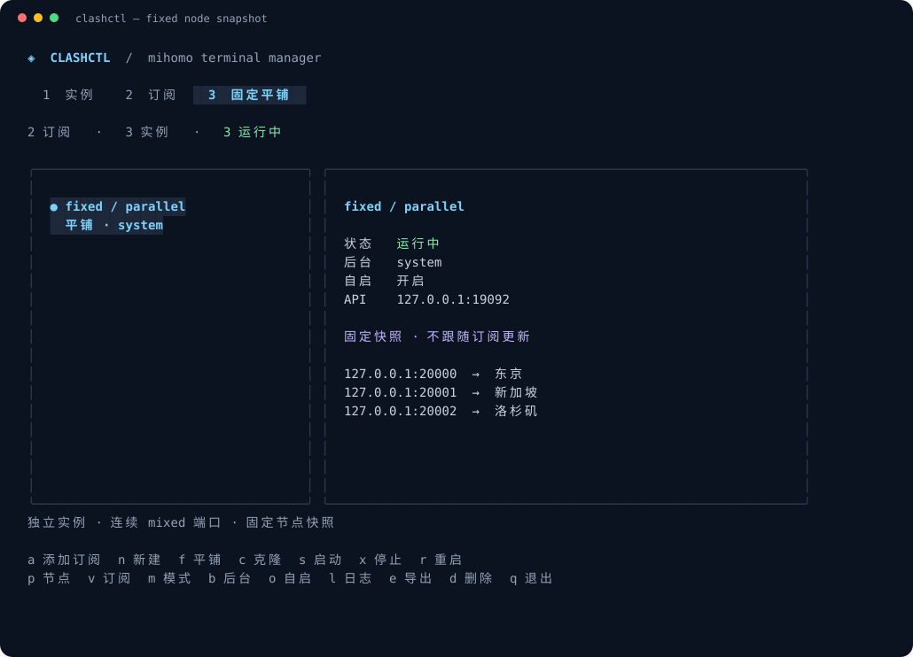

# clashctl

Linux 下的 mihomo TUI 管理工具，支持多订阅、多实例和固定节点平铺。



## 安装

```bash
bash <(curl -fsSL https://github.com/chensunlai/clash_mihomo/releases/latest/download/install.sh)
```

安装向导会依次询问安装目录（默认 `~/.local/clash_mihomo`）、确认安装、是否写入 `~/.bashrc`，以及是否立即打开 TUI。自动选择 x86_64 / ARM64 二进制并安装 mihomo 核心。也支持 `curl -fsSL <安装脚本链接> | bash`。

选择写入 bashrc 后，新终端直接运行 `clashctl`；当前终端可执行 `source ~/.bashrc`。选择不写入时，使用 `<安装目录>/bin/clashctl`。

预设目录或版本后继续交互安装：

```bash
bash <(curl -fsSL https://github.com/chensunlai/clash_mihomo/releases/latest/download/install.sh) --dir "$HOME/.local/clash_mihomo" --version v1.0.2
```

自动化安装可用 `--yes` 跳过提问；是否修改 bashrc 需显式指定：

```bash
bash <(curl -fsSL https://github.com/chensunlai/clash_mihomo/releases/latest/download/install.sh) --yes --dir "$HOME/.local/clash_mihomo" --init-bashrc
```

其他选项：`--skip-core` 暂不安装核心，`--no-init-bashrc` 不修改 bashrc，`--no-link` 不创建命令链接。重新安装可以更新管理器，已有订阅和实例保留，bashrc 中的初始化区块不会重复。也可用 `clashctl --home DIR` 管理另一套配置。

## 订阅与实例

1. 按 `a` 添加订阅名称和链接。链接需返回 Clash YAML。
2. 按 `n` 创建实例，选择订阅、mixed 端口、监听地址和后台方式。端口留空自动分配。
3. 按 `s` 启动，再按 `p` 选择策略组和节点。
4. 按 `c` 克隆实例，可让同一订阅的多个实例使用不同节点；按 `v` 切换选中实例的订阅。

默认入口只监听 `127.0.0.1`，需要其他设备访问时填写 `0.0.0.0`。不同订阅、同一订阅的多个实例、多个平铺实例和多个 TUI 窗口均可并行运行。

| 按键 | 操作 |
| --- | --- |
| `1` / `2` / `3`、Tab | 切换实例 / 订阅 / 固定平铺页 |
| `↑` / `↓` | 选择项目 |
| `a` / `n` / `c` | 添加订阅 / 新建实例 / 克隆实例 |
| `s` / `x` / `r` | 启动 / 停止 / 重启 |
| `p` / `v` | 切换节点 / 切换订阅 |
| `m` / `u` | 切换规则、全局、直连模式 / 更新订阅及关联实例 |
| `b` / `o` | 切换后台方式 / 开关 systemd 自启 |
| `f` / `e` | 创建固定平铺 / 导出平铺配置 |
| `l` / `d` | 日志 / 删除选中项目 |
| `i` / `q` | 安装核心 / 退出 TUI，代理继续后台运行 |

表单中 Tab 下一项，左右键选择选项，Ctrl+S 保存，Esc 取消。节点选择器可输入筛选，Enter 切换，Ctrl+T 测速。

## 固定节点平铺

1. 按 `f` 填写名称、起始端口、监听地址和后台方式。
2. 从已添加的订阅列表中选择订阅，用 Space 勾选节点，Ctrl+A 全选筛选结果，Enter 确认。按 `a` 继续选择其他订阅的节点；再次选择同一订阅可以修改勾选，不会重复加入。按 `l` 也可导入本地 YAML 文件。
3. 查看端口预览，按 Enter 创建，再按 `s` 启动。

例如从两个订阅依次选中三个节点，起始端口为 `20000`：

```text
127.0.0.1:20000 → 订阅 A / 节点 X
127.0.0.1:20001 → 订阅 A / 节点 Y
127.0.0.1:20002 → 订阅 B / 节点 Z
```

每个端口同时支持 HTTP 和 SOCKS，固定绑定一个节点。只提取选中的节点，不使用原配置的规则、DNS、策略组或其他入口。配置保存后不跟随订阅更新，也不受原文件改动影响。按 Enter 查看完整映射，按 `e` 导出独立 YAML，按 `c` 克隆到另一段端口。

输入文件可包含顶层节点、inline provider 节点或已有本地 provider 缓存；不会联网拉取 provider。跨文件重名节点会自动加前缀，同一文件中的重名节点需先改名。节点的 `dialer-proxy` 可以依赖其他具体节点，不能依赖原策略组。

## 后台管理

创建实例时选择后台方式，或停止后按 `b` 切换：

| 方式 | 使用方法 |
| --- | --- |
| `nohup` | 无需 sudo，退出终端后继续运行，不支持开机自启 |
| systemd 用户服务 | 当前用户管理，按 `o` 开关自启 |
| systemd 系统服务 | 操作时需要 sudo，按 `o` 开关自启，核心以当前用户运行 |

用户服务希望无人登录时也能自启，执行一次：

```bash
sudo loginctl enable-linger "$USER"
```

按 `x` 只停止当前运行；若希望机器重启后也不启动，关闭 `o`。系统服务在 TUI 中会提示 sudo 授权；命令行操作前可先执行 `sudo -v`。

## 命令行

```bash
clashctl sub add --name A --url 'https://example.com/clash.yaml'
clashctl sub add --name B --url 'https://example.net/clash.yaml'
clashctl new --name work --sub A --port 17890 --backend user
clashctl clone --from work --name work-2 --port 17891
clashctl start work
clashctl start work-2
clashctl groups work
clashctl select --instance work --group PROXY --node '节点名称'
clashctl switch --instance work-2 --sub B
clashctl sub update A
clashctl autostart --instance work --enable
clashctl autostart --instance work --enable=false

clashctl flat --name fixed --port 20000 --backend nohup \
  --file /path/a.yaml --node '节点 X' --node '节点 Y' \
  --file /path/b.yaml --node '节点 Z'
clashctl start fixed
clashctl export --instance fixed --out /tmp/fixed.yaml
clashctl status
```

`--backend` 可选 `nohup`、`user`、`system`。运行 `clashctl help` 查看全部命令。
